# 🚀 Cohete del Granero

**Juego 3D de diseño de misiones espaciales** para el reto *Space Mission Design Game* de NASA Space Apps Challenge 2026.

**▶ Jugar en el navegador:** https://tommycc2010-hub.github.io/cohete-del-granero/

**💻 Descargar para Windows:** [CoheteDelGranero-windows.zip](https://github.com/tommycc2010-hub/cohete-del-granero/releases/latest/download/CoheteDelGranero-windows.zip) (195 MB). Descomprímelo y abre `CoheteDelGranero.exe`. Como la app no está firmada, Windows puede avisar: pulsa *Más información → Ejecutar de todas formas*.

**📱 En el celular:**
- **Android:** descarga [CoheteDelGranero-android.apk](https://github.com/tommycc2010-hub/cohete-del-granero/releases/latest/download/CoheteDelGranero-android.apk), ábrelo y acepta instalar apps de origen desconocido.
- **Android o iPhone sin instalar nada:** abre la página del juego en el navegador y elige *Añadir a la pantalla de inicio* (en iPhone, desde Safari → Compartir). Queda como una app, a pantalla completa y funciona sin internet.
- Se juega en horizontal con controles táctiles: joystick a la izquierda, arrastrar a la derecha para mirar, y botones para usar (E), saltar, correr, el teléfono, guardar y pausa. En el cohete: 🔥 impulso, 🛑 frenar y 🏠 volver.

**🎬 Ver el tráiler (1:20):** https://tommycc2010-hub.github.io/cohete-del-granero/trailer-cohete-del-granero.mp4

**Equipo:** Siderense Rocket Labs

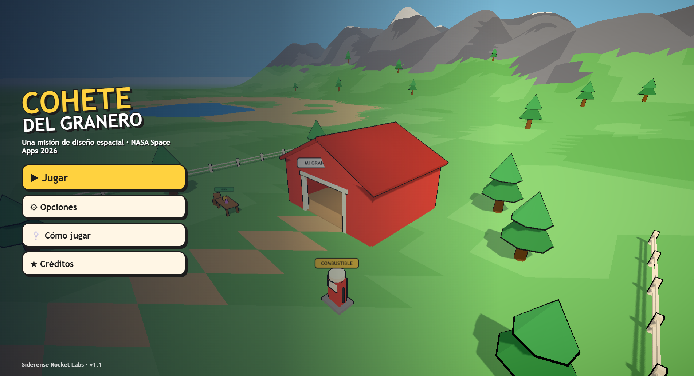

---

## La idea

Encuentras un cohete abandonado y averiado en un granero. Junto al **Dr. Nova**, un científico que te guía durante todo el viaje, lo reparas pieza por pieza, despegas, aterrizas en otros mundos y vuelves con muestras que vendes para seguir mejorándolo.

Cada destino es más lejano y más difícil que el anterior: **Mercurio, Venus, Marte, Ío (la luna volcánica de Júpiter) y Europa**. El viaje termina sobre el hielo de Europa, siguiendo una señal que viene del océano escondido bajo la superficie.

## El problema que resuelve

Diseñar una misión espacial obliga a equilibrar demandas que compiten entre sí: objetivos, diseño de la nave, instrumentos, presupuesto, energía, masa, comunicaciones y restricciones del viaje. Para la mayoría de los estudiantes esos trade-offs se quedan en la teoría.

En *Cohete del Granero* **el jugador siente cada trade-off en carne propia**. La regla central del juego es la misma que en una misión real: **cada mejora añade masa, y más masa gasta más combustible**. Un tanque más grande permite ir más lejos, pero pesa; un escudo protege la carga, pero también pesa. No hay una respuesta correcta: hay decisiones con consecuencias.

## Cómo cubre el reto

| Elemento del reto | Cómo aparece en el juego |
|---|---|
| **Definir el objetivo** | Antes de cada viaje, en el **Laboratorio de Diseño de Misión**, eliges uno de 3 objetivos científicos del destino (15 en total), cada uno con los instrumentos y los datos que necesita. |
| **Lanzador y órbita** | 3 lanzadores con distinta capacidad y precio: si la nave pesa más de lo que el lanzador lleva, no despega. 3 tipos de misión: sobrevuelo (barato y corto), orbitador (observa sin bajar) y aterrizaje (más ciencia y más riesgo). |
| **Datos y comunicaciones** | Los instrumentos generan datos, que se guardan en una memoria limitada y la antena envía a la Tierra más despacio cuanto más lejos estás. Si la memoria se llena, se pierde ciencia. |
| **Evaluación y puntaje** | Cada misión recibe un puntaje (ciencia, objetivo, presupuesto y riesgos) con 0 a 3 estrellas, un **"¿por qué salió así?"**, la misión real a la que se parece tu diseño y un récord por destino. |
| **Equipos de hasta 4, en línea** | Cada persona juega desde su teléfono o computadora: una crea una **sala** con un código de 4 letras y las demás se unen. Dirección, Ciencia, Ingeniería y Operaciones se reparten el diseño: en el laboratorio cada quien solo cambia la parte de su rol, cada rol tiene una meta que choca con las demás y el cohete solo despega si todo el equipo lo aprueba. En el granero se ven caminando; durante el vuelo, los demás siguen la misión en vivo en el **Control de Misión** (imagen, telemetría) y mandan mensajes por radio, que tardan lo mismo que la señal real. También hay modo equipo en un solo dispositivo. |
| **Objetivos de misión** | Además, cada destino tiene una misión principal basada en un hecho real y 5 secundarias. Cumplir la principal abre el siguiente destino. |
| **Diseño de la nave** | Diez mejoras: motor, tanque, escudo térmico, sensores, antena, traje, tanque de oxígeno, paneles solares, batería y generador RTG. Cada una cambia el modelo 3D del cohete. |
| **Instrumentos científicos** | 7 instrumentos para elegir (cámara, espectrómetro, radar, cámara infrarroja, magnetómetro, sismómetro y estación meteorológica), cada uno con su masa, energía, costo, datos por segundo y valor científico, y dónde funciona (órbita o suelo). Además, las misiones usan estación meteorológica, sismógrafo y antenas. |
| **Presupuesto** | El dinero viene de vender muestras y cumplir misiones; el combustible y cada mejora cuestan. |
| **Masa** | Un factor de masa que crece con cada mejora y sube el consumo de combustible de cada viaje. |
| **Energía** | Una batería que los sistemas gastan durante el viaje. Los paneles solares rinden según la luz real de cada lugar (6.7 veces la de la Tierra en Mercurio, 27 veces menos en Júpiter); lejos del Sol hace falta un generador de radioisótopos (RTG). Sin energía se apagan los instrumentos y el cohete no recarga el oxígeno. Además, la misión de Marte consiste en devolverle la energía a un rover cubierto de polvo. |
| **Comunicaciones** | La antena: sin el nivel suficiente no se puede llegar a Europa, y si se avería al aterrizar los sensores no identifican nada. Los mensajes del Dr. Nova llegan con el retraso real de la señal (de 3 a 22 minutos de luz en Marte, de 33 a 53 en Júpiter), así que el aterrizaje es autónomo. |
| **Restricciones del viaje** | Ventanas de lanzamiento: cada destino se alinea cada cierto tiempo (el periodo real dividido por 10) y fuera de la ventana el viaje gasta hasta un 60 % más; esperar cuesta mantenimiento. Además: combustible de ida y vuelta, una reserva para volver, el aterrizaje contra la gravedad real de cada lugar y averías si se toca suelo demasiado rápido. |

## Capturas

| | |
|---|---|
| 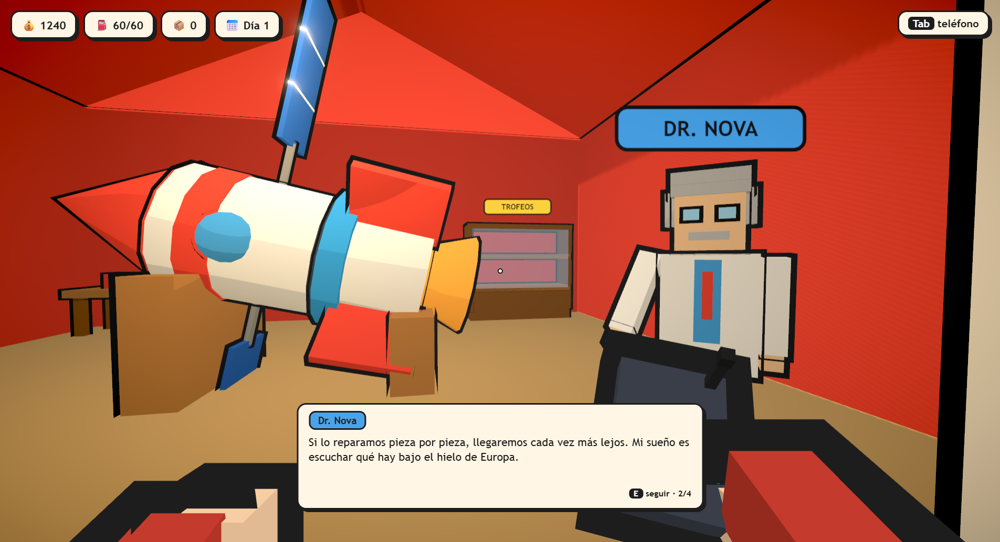 | 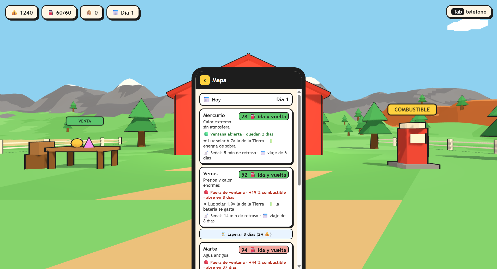 |
| El Dr. Nova aconseja según tu partida | Ventanas de lanzamiento, luz solar y retraso de la señal |
| 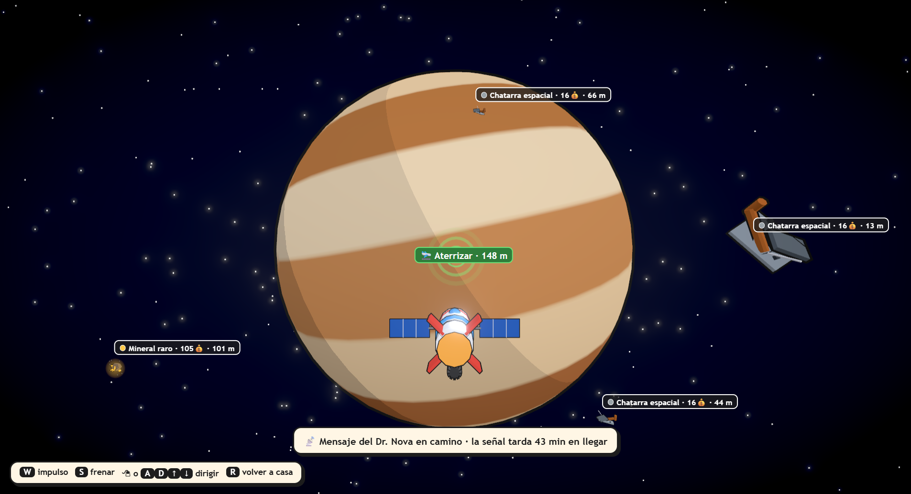 | 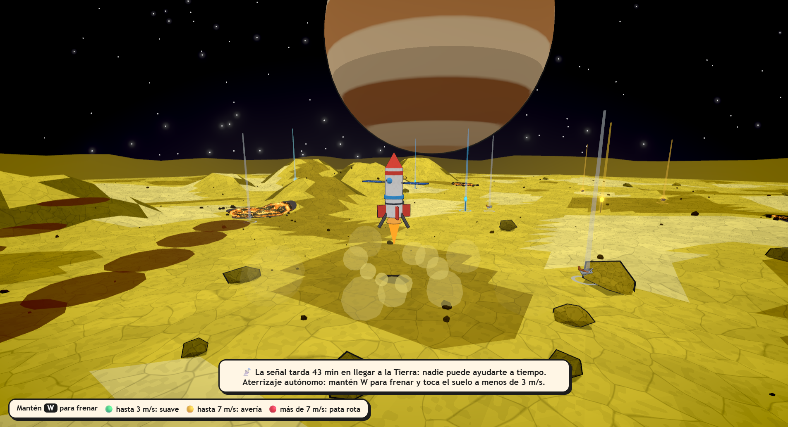 |
| Vuelo con paneles solares hacia Júpiter | Descenso autónomo en Ío, frenando contra su gravedad |
| 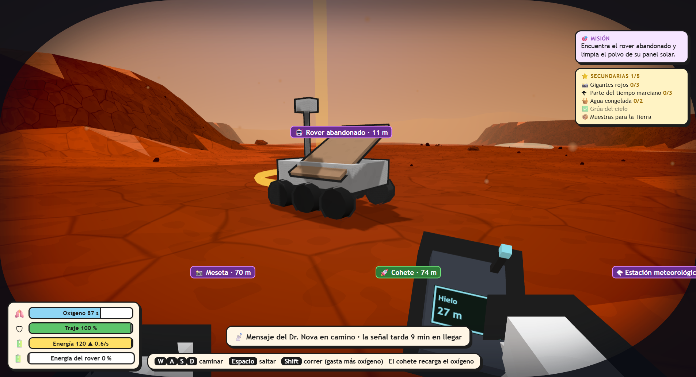 | 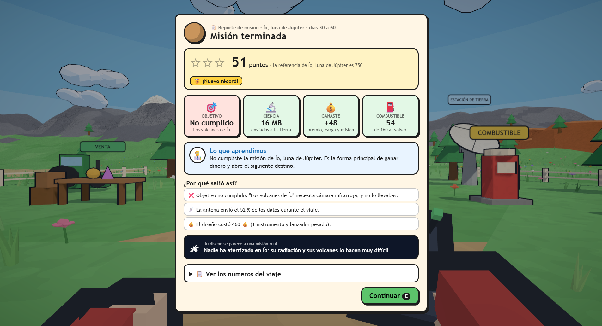 |
| Misión en Marte: reactivar un rover cubierto de polvo | Reporte de misión con la lección del viaje |
| 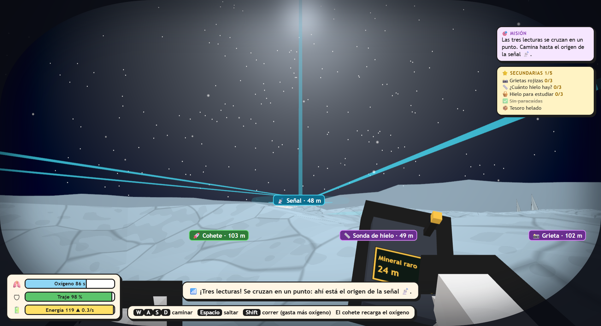 | 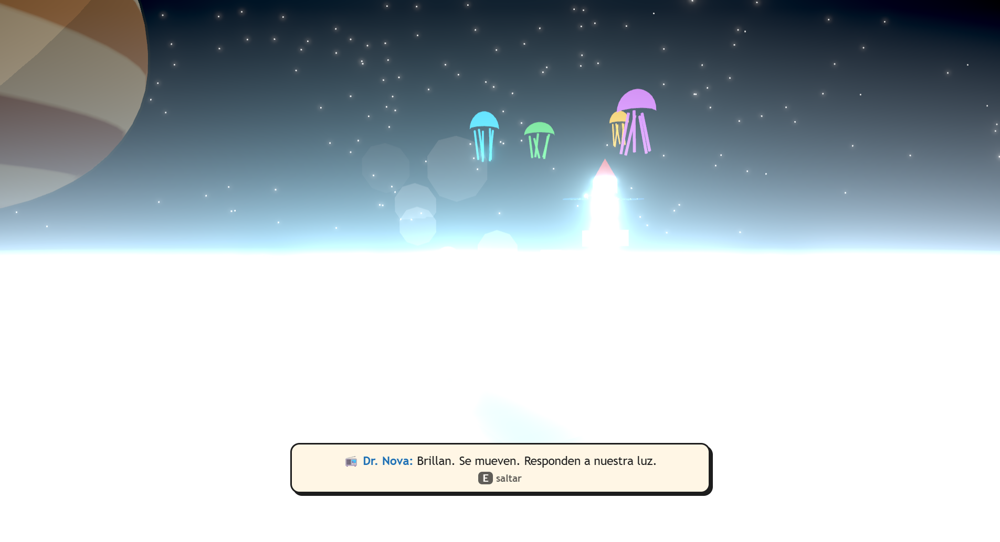 |
| Tres antenas triangulan la señal de Europa | El final bajo el hielo |
| 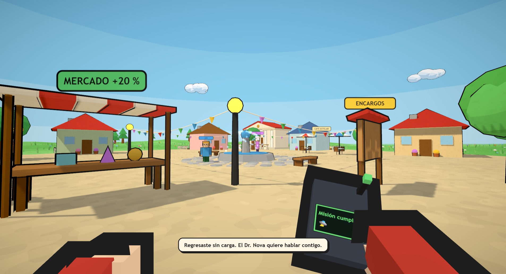 | 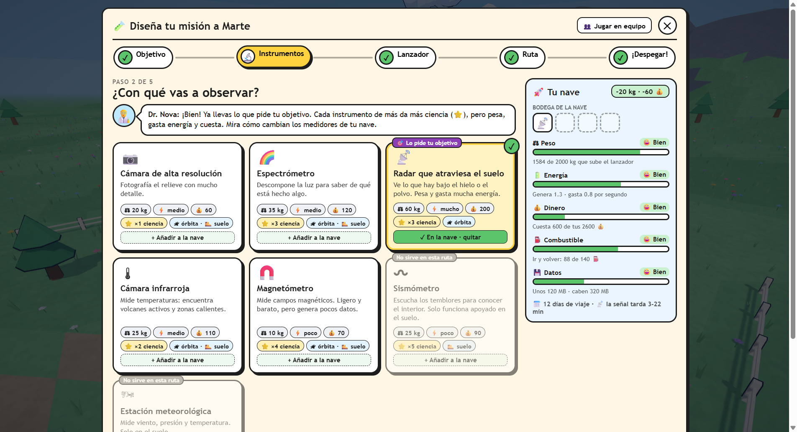 |
| El pueblo, su mercado y sus huertos | Laboratorio de Diseño de Misión |
| 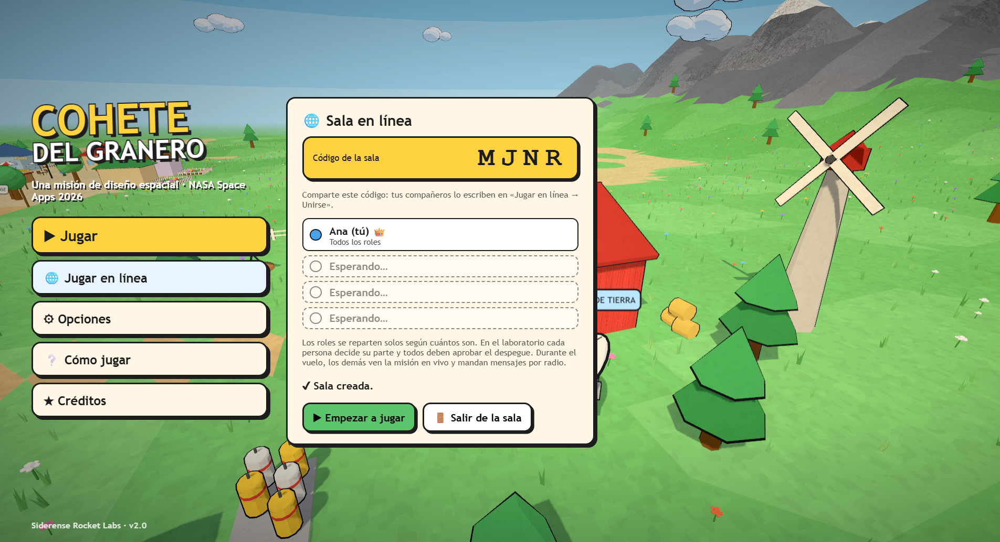 | |
| Sala en línea: hasta 4 personas, cada una con su rol | |

## La ciencia detrás del juego

- **Gravedad real** de cada lugar al saltar y al aterrizar: Venus 0.90, Mercurio y Marte 0.38, Ío 0.18 y Europa 0.13 veces la de la Tierra.
- **Ventanas de lanzamiento:** los planetas se alinean cada cierto tiempo. A Marte, la ventana se abre cada 26 meses; por eso las misiones reales salen todas casi a la vez.
- **Retraso de la señal:** la luz tarda minutos en llegar. Un aterrizaje en Marte no se puede pilotar desde la Tierra: la nave aterriza sola.
- **Luz solar real:** cae con el cuadrado de la distancia al Sol. Por eso las sondas que van más allá de Marte suelen llevar generadores de radioisótopos; la misión Juno llegó a Júpiter con paneles solares enormes.
- **Mercurio:** en los cráteres de sus polos hay hielo de agua en sombra permanente, aunque es el planeta más cercano al Sol. En el juego, al sol el traje se calienta y hay que avanzar de sombra en sombra.
- **Venus:** su superficie ronda los 465 °C con una presión unas 90 veces la de la Tierra. Las sondas soviéticas Venera aguantaron como mucho unas dos horas; en el juego, la estación se derrite si no la instalas a tiempo.
- **Marte:** el polvo sobre los paneles solares dejó sin energía a misiones reales.
- **Ío:** el cuerpo con más volcanes activos del sistema solar. Júpiter es un gigante de gas sin suelo, por eso se aterriza en su luna.
- **Europa:** los datos indican un océano de agua salada bajo el hielo. La NASA envió la misión Europa Clipper a estudiar si podría ser habitable.

- **Cada bioma tiene sus fenómenos:** remolinos de polvo y las lunas Fobos y Deimos en Marte, penachos volcánicos de azufre con forma de paraguas en Ío (como los que fotografió la sonda Voyager), y posibles géiseres de vapor de agua en Europa, de los que el telescopio Hubble vio indicios.

> **Ficción y realidad:** el final con vida extraterrestre es ficción, y el propio juego lo aclara en la pantalla final. Hoy no hay evidencia de vida en Europa.

Los datos de los planetas están en [`src/datos.js`](src/datos.js). Son conocimiento general de divulgación y se reemplazarán por la base de datos oficial de la NASA cuando se publique.

## Cómo se juega

1. **En el granero** compras combustible, vendes muestras y mejoras el cohete. El Dr. Nova da consejos según tu partida, con un nivel de confianza en cada dato.
2. **Diseñas la misión** en el laboratorio, paso a paso y con una pregunta por pantalla: ¿qué quieres descubrir? (objetivo), ¿con qué vas a observar? (instrumentos), ¿qué cohete te sube? (lanzador) y ¿cómo visitas el planeta? (ruta). El Dr. Nova explica cada paso y, a un lado, **Tu nave** muestra con medidores sencillos (😀 bien, 😬 justo, ⛔ no alcanza) cómo cada decisión cambia el peso, la energía, el dinero, el combustible y los datos, y qué cambió (+35 kg, +120 💰). El diseño madura de idea a listo (los niveles CML del JPL).
3. **Despegas** y vuelas hasta el destino; mientras tanto, los instrumentos observan y la antena envía los datos. Lo que flota en órbita vale poco.
4. **Aterrizas a mano** (si la misión es de aterrizaje), frenando contra la gravedad. Si tocas el suelo rápido, el cohete se avería y hay que buscar piezas para repararlo.
5. **Exploras a pie** con oxígeno y traje limitados. El cohete recarga el oxígeno; las zonas peligrosas dañan el traje.
6. **Cumples la misión** del lugar, recoges muestras y vuelves a casa a venderlas. En el pueblo, Villa Siderense, el mercado paga un 20 % más.
7. **Ves el resultado:** estrellas y puntos, cuatro fichas (objetivo, ciencia, lo que ganaste y el combustible que sobró), lo que aprendimos según el Dr. Nova, por qué salió así y a qué misión real se parece tu diseño. Los números del viaje quedan a un clic.

**Partidas guardadas:** hay **4 ranuras**, cada una con una partida distinta. El juego guarda solo cuando estás en el granero, y además puedes guardar **en cualquier momento**, incluso en órbita o explorando un planeta: desde la pausa (Esc → Guardar partida) o con la tecla **G** (guardado rápido). Al cargar una partida guardada en un planeta, apareces donde estabas, con el mismo oxígeno, traje, carga y averías. En la app de escritorio las partidas quedan en la propia app y se conservan al cerrarla.

### Más allá de la misión principal

- **1 misión principal y 5 secundarias en cada lugar** (25 secundarias en total), cada una con su recompensa y un dato real al cumplirla:
  - 📸 **Fotografiar** 3 sitios marcados, como cráteres, volcanes o lagos de lava.
  - **Instalar 3 sensores**, por ejemplo termómetros, medidores de radiación o sondas de hielo, que quedan funcionando en el planeta.
  - 🧺 **Traer** ciertos objetos de ese lugar, en uno o varios viajes.
  - 🪶 **Aterrizar** a menos de 2 m/s.
  - 📦 **Volver** con carga de cierto valor en un solo viaje.
- **Mochila 🎒:** si te quedas sin oxígeno, lo que llevabas encima queda en una mochila donde caíste, marcada en pantalla. Despiertas junto al cohete y tienes que volver a por ella.

- **Conversaciones con opciones:** con el Dr. Nova eliges de qué hablar (qué hacer, datos del próximo destino o su historia con la señal de Europa). Los vecinos cambian lo que dicen según avanzas.
- **Encargos del pueblo:** cada vecino te pide algo del espacio (hielo, chatarra, un cristal lunar, una piedra de Marte) a cambio de dinero o de un descuento en el taller.
- **Imprevistos con base real:** lluvias de micrometeoritos en la ruta de aterrizaje (cada impacto cuesta combustible) y tormentas solares en Mercurio y Marte, con 15 segundos de aviso para refugiarte en el cohete, igual que los astronautas se protegen de la radiación.
- **Eventos aleatorios en el espacio**, uno como mucho por viaje:
  - 🛰️ **Sonda perdida** fuera de la ruta: desviarte cuesta combustible, pero vale mucho.
  - 🌠 **Cometa:** su cola apunta siempre lejos del Sol. Si la atraviesas, el colector atrapa hielo.
  - ⛽ **Fuga de combustible:** mantén E para sellarla, como el agujero de 2 mm que sellaron en la Estación Espacial en 2018.
  - ☀️ **Tormenta de partículas:** los sensores entran en modo seguro, como en las sondas reales, y la nave se desvía.
  - 🧭 **Giroscopio averiado:** la nave gira sola y hay que corregir el rumbo. El telescopio Hubble trabaja con un solo giroscopio desde 2024.
  - 📡 **El eco de Europa:** después de Marte, la antena capta el pulso que oyó el Dr. Nova hace treinta años.
- **Eventos en la superficie:** un meteorito cae cerca y deja una muestra en su cráter (en Venus no, porque la atmósfera espesa frena las rocas pequeñas). También puede haber sismos que dejan al descubierto un mineral; la sonda InSight registró más de 1300 en Marte.
- **El granero cuenta tu progreso:** un tablero con una tarjeta por destino que recibe un sello verde al cumplir la misión, una vitrina con una copa por logro, un telescopio que muestra qué ventanas de lanzamiento están abiertas y una estación de tierra cuya antena, paneles y tanques crecen con las mejoras del cohete.
- **Villa Siderense tiene vida:** el Museo del Espacio paga el 150 % por la primera pieza de cada tipo y la expone en su pedestal. También hay un tablón de encargos, el Café Estelar, banderines y una fuente con agua.
- **17 logros** que se ven en el teléfono, como aterrizar a menos de 1 m/s, saltar con menos de 0.2 g o atrapar hielo de un cometa.

### Controles

| Tecla | Acción |
|---|---|
| W A S D | Caminar · en el cohete: impulso y dirección |
| Mouse | Mirar · dirigir el cohete |
| Espacio | Saltar |
| Shift | Correr (gasta más oxígeno) |
| E | Usar, hablar, reparar |
| Tab | Teléfono: estado, taller, mapa, misiones, encargos, logros y diario |
| 1 – 4 | Elegir una respuesta en las conversaciones |
| R | Volver a casa desde la órbita |
| G | Guardado rápido en la ranura actual |
| M | Sonido sí / no |
| F11 | Pantalla completa (app de escritorio) |

## Tecnología

- **[Three.js](https://threejs.org/)** para el 3D, con estilo low-poly y materiales "toon" inspirados en el juego Schedule I.
- **[Vite](https://vite.dev/)** para compilar la versión web.
- **[Electron](https://www.electronjs.org/)** para la app de escritorio de Windows.
- **Todo se genera con código:** modelos 3D, terrenos, texturas de planetas, sonidos y música (una pieza distinta para el granero, el espacio y cada planeta). El juego no usa archivos externos de arte ni audio.
- **Multijugador en línea:** conexión directa entre navegadores (WebRTC) con [PeerJS](https://peerjs.com/). Su servidor público gratuito solo sirve para que los jugadores se encuentren por el código de la sala; no guarda partidas ni datos personales. El anfitrión lleva la partida y la comparte; la imagen del vuelo se transmite como video en vivo.
- **El granero vivo:** cielo por bandas con un sol con contorno, nubes esponjosas sombreadas en 3 tonos, miles de matas de pasto y flores que se mecen con el viento (instancias en la GPU), un lago con ondas, espuma, juncos y nenúfares, mariposas y bandadas de pájaros. El pueblo tiene huertos con cerca, árboles y adoquines alrededor de la fuente.
- **El espacio:** nebulosas por bandas, la Vía Láctea y el Sol a lo lejos, estrellas de colores que titilan, polvo espacial que da sensación de velocidad, atmósferas alrededor de Venus, Marte y Júpiter, y sus lunas reales: Fobos y Deimos en Marte, y las cuatro galileanas (Ío, Europa, Ganímedes y Calisto) en Júpiter.
- **Cohete y efectos:** llama de 3 capas (roja, naranja y un núcleo que brilla) con contorno, nubes de humo al despegar, polvo facetado al aterrizar y un cohete con más detalle (marco de la ventanilla, remaches, juntas, punta metálica y aros del motor según su nivel).
- **Interfaz animada:** el menú y los paneles entran con un pequeño rebote, las estrellas de la evaluación aparecen una a una y las tarjetas del laboratorio se levantan al pasar el mouse. Si el sistema pide menos movimiento, las animaciones se apagan.
- **Cielos de los planetas:** cielo con degradado y halo alrededor del Sol (azulado en Marte, donde los atardeceres son azules), montañas en el horizonte, rocas low-poly con contorno y cientos de guijarros dibujados de una sola vez (instancias).
- **Texturas procedurales en el estilo de la lava:** el suelo de cada planeta tiene placas agrietadas con manchas de tono, las rocas y las laderas tienen costra con grietas, el granero tiene tablas de madera y el pasto tiene matices. Todo se calcula en la GPU (sin imágenes) y por bandas de color, para encajar con el sombreado toon.
- **Lava creíble en estilo toon:** relieve en 3D (placas de costra levantadas con luz y sombra por facetas, grietas y lava fundida hundidas, bloques de costra flotando), placas que derivan despacio, grietas encendidas, zonas fundidas, una orilla que brilla (como el lago de lava Loki, en Ío), reborde de roca y brasas que suben. Cada lugar tiene su paleta: lava naranja en Venus, casi amarilla de tan caliente en Ío y roca al rojo vivo en Mercurio.
- **HUD ordenado en los planetas:** arriba, dónde estás y qué llevas; abajo a la izquierda, un panel con oxígeno, traje y energía. La ayuda de controles se desvanece sola.
- **Postprocesado:** antialiasing MSAA, resplandor (bloom) ajustado a cada escena, para que brillen la lava, los cristales y las llamas, y un viñeteado suave. Se activa con la calidad gráfica alta.
- **Calidad automática:** si el juego va a menos de 32 imágenes por segundo durante 8 segundos, baja solo la calidad gráfica un nivel y avisa.
- **Menú principal y opciones:** volumen, música, sensibilidad del mouse, campo de visión y tres niveles de calidad gráfica para computadoras modestas.
- **Simulador de balance:** un script que juega miles de partidas con las reglas reales y mide cuántos viajes y minutos toma terminar. Hoy da unos 8,5 viajes y 32 minutos de media, y el 100 % de las partidas termina.

### Estructura

```
src/
  main.js         bucle principal, modos de juego y pantalla
  reglas.js       economía, mejoras, combustible, oxígeno y misiones (sin nada visual)
  datos.js        planetas, objetos y misiones
  granero.js      el mundo del granero: relieve, lago y pueblo
  pueblo.js       Villa Siderense y sus vecinos
  espacio.js      vuelo en órbita
  superficie.js   biomas de cada planeta para explorar a pie
  misiones.js     las cinco misiones y sus puzzles
  final.js        escena final en Europa
  jugador.js      movimiento en primera persona, salto y gravedad
  manos.js        brazos y escáner en primera persona
  cientifico.js   personajes y consejos del Dr. Nova
  dialogos.js     conversaciones con opciones, encargos y saludos de los vecinos
  eventos.js      eventos aleatorios en el espacio y en la superficie
  secundarias.js  puntos de las misiones secundarias y mochilas en el suelo
  diseno.js       diseño de misión: instrumentos, lanzadores, objetivos, datos, puntaje y modo equipo
  laboratorio.js  Laboratorio de Diseño de Misión, paso a paso
  red.js          conexión del multijugador en línea (salas, mensajes y video), sin nada visual
  multijugador.js sala en el menú, compañeros en el granero y Control de Misión
  paisaje.js      cielo, nubes, pasto, flores, lago, mariposas y pájaros del granero
  efectos.js      llama del cohete, humo del despegue y polvo del aterrizaje
  lava.js         charcos de lava: shader de costra y grietas, reborde y brasas
  tactil.js       controles táctiles para el celular (joystick, mirar y botones)
android/                   app de Android (Capacitor); el APK lo compila GitHub Actions
public/                    icono, manifiesto y service worker de la app instalable (PWA)
  granja.js       alrededores del granero: tablero, vitrina, telescopio y estación de tierra
  postpro.js      resplandor y viñeteado (calidad alta)
  objetos.js, particulas.js, ambiente.js   modelos de las muestras, partículas y fenómenos de cada bioma
  telefono.js     menú del teléfono
  informe.js      reporte de misión (pantalla de resultados) y lección de cada viaje
  guardado.js     4 ranuras de guardado, en casa o en plena misión
  menu.js         menú principal, pausa y opciones
  musica.js       música ambiental generada en el momento
  cohete.js, estilo.js, terreno.js, ruido.js, sonido.js, tutorial.js
herramientas/simular.mjs   simulador de balance
herramientas/capturas.cjs  genera las capturas del README
electron/main.cjs          app de escritorio
prototipo-2d/              primer prototipo del juego, en 2D
```

## Ejecutar el proyecto

Requiere [Node.js](https://nodejs.org/) 20 o más reciente.

```bash
npm install
npm run dev          # versión web para desarrollo (http://localhost:5173)
npm run build        # versión web lista para publicar, en dist/
npm run app          # abrir como app de escritorio
npm run empaquetar   # crear salida/CoheteDelGranero-windows.zip
npm run simular      # simular partidas para revisar el balance
```

Cada cambio que se sube a la rama `main` se publica solo en GitHub Pages.

**Modo demo:** agregando `?demo` a la dirección (https://tommycc2010-hub.github.io/cohete-del-granero/?demo) el juego empieza con todo desbloqueado y no guarda el progreso. Sirve para presentar o grabar sin jugar desde el principio. El guion del video está en [`docs/guion-video.md`](docs/guion-video.md).

`npm run capturas` vuelve a generar las capturas de `docs/capturas` (necesita internet para la de la sala en línea).

**Probar el multijugador:** abre el juego en dos pestañas (o en la computadora y el teléfono). En una, *Jugar en línea → Crear sala*; en la otra, *Unirse* con el código.

**Tráiler narrado:** `herramientas/trailer` graba el juego cuadro a cuadro, añade la narración, subtítulos y la música del juego, y lo monta con ffmpeg en `salida/trailer-cohete-del-granero.mp4`:

```bash
pip install piper-tts
python -m piper.download_voices es_ES-sharvard-medium
python herramientas/trailer/narrar.py <carpeta de la voz> salida/trailer
npm run trailer
```

La narración usa [Piper](https://github.com/OHF-Voice/piper1-gpl), un sintetizador de voz de código abierto que funciona sin conexión.

## Próximos pasos

- Cargar la base de datos oficial de la NASA en lugar de los valores de ejemplo.

## Uso de inteligencia artificial

Parte del código, los textos y el diseño se hicieron con ayuda de Claude, un asistente de IA de Anthropic, bajo la dirección del equipo.

## Créditos

Hecho por **Siderense Rocket Labs** para NASA Space Apps Challenge 2026. NASA no respalda este proyecto: el nombre se usa solo para identificar el evento.
